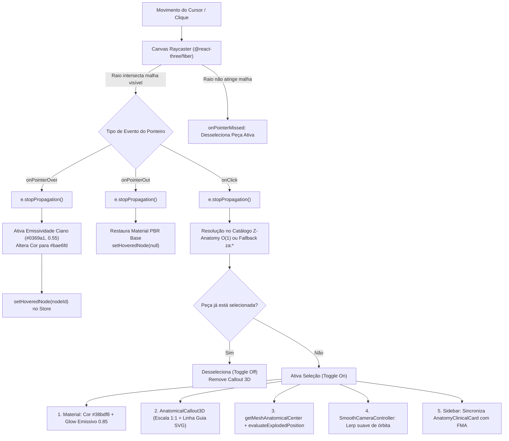

# 🧬 Atlas 3D de Anatomia Médica (Z-Anatomy & BodyParts3D)

[](https://www.typescriptlang.org/)
[](https://react.dev/)
[](https://threejs.org/)
[](https://vitejs.dev/)
[-brightgreen.svg)](https://vitest.dev/)
[](https://cloud.google.com/run)
[](https://creativecommons.org/licenses/by-sa/4.0/)

Plataforma médica e educacional em 3D de alta fidelidade para estudo e dissecação virtual do **corpo humano completo**, baseada nas malhas escaneadas em alta resolução do projeto aberto **Z-Anatomy** e **BodyParts3D / DBCLS**, com **Exploded View Homolateral** (visão explodida centrífuga desarticulando peças reais no espaço 3D sem inversão bilateral), **Dissecção Tomográfica Multiplanar (MPR)**, **Callout 3D Compacto em Escala 1:1** com linha guia vetorial, seleção interativa via raycasting GPU e navegação taxonômica pela **Terminologia Anatomica internacional (TA2)** com códigos FMA.

> **Nota**: Uso estritamente educacional. Consulte o documento canônico de design system, tokens visuais e governança 3D em [`designer.md`](designer.md).

---

## 🌟 Funcionalidades Principais

### 1. Esqueleto Humano Completo (335 Ossos Reais Desarticulados)
- **Crânio e Viscerocrânio**: 40 ossos individuais (Frontal, Parietais D/E, Occipital, Temporais, Esfenoide, Etmoide, Mandíbula, Maxilas, Zigomáticos, Nasais, Lacrimais, Palatinos e Vômer).
- **Coluna Vertebral**: C1 (Atlas) a C7 (Proeminente), T1 a T12, L1 a L5, Osso Sacro e Cóccix.
- **Caixa Torácica**: Esterno completo (Manúbrio, Corpo e Processo Xifoide), Costelas 1 a 12 bilaterais e cartilagens costais.
- **Cíngulo e Membros Superiores**: Clavículas, Escápulas, Úmeros, Rádios, Ulnas, Ossos do Carpo, Metacarpos e Falanges.
- **Cíngulo Pélvico e Membros Inferiores**: Ílios, Ísquios, Púbis, Fêmures, Patelas, Tíbias, Fíbulas, Tarsos, Metatarsos e Falanges.

### 2. Filtragem Topográfica, Estratigrafia Cirúrgica e Multi-Sistema
- **Seleção Concorrente Multi-Sistema**: Ativação simultânea de múltiplos sistemas anatômicos ordenada estratigraficamente de fora para dentro, com controle de **Camadas Cirúrgicas (`1/6` a `6/6`)** e sliders individuais de opacidade por sistema.
- **Recorte Topográfico por Região (`isNodeInRegion`)**:
  - **Crânio & Face**: Isola as estruturas cranianas e centraliza no meio do viewport com zoom cirúrgico (`3.1x`).
  - **Coluna Vertebral**: Foco nas vértebras cervicais, torácicas, lombares e sacro com descompactação axial vertical.
  - **Caixa Torácica**: Foco nas costelas, esterno e vísceras intratorácicas com abertura em leque.
  - **Membros Superiores**: Ombro, braço, antebraço e mão.
  - **Pelve & Quadril**: Cintura pélvica, sacro e órgãos pélvicos.
  - **Membros Inferiores**: Fêmur, joelho, perna e pé.
  - **Corpo Inteiro**: Arcabouço corporal completo articulado.

### 3. Exploded View Homolateral em GPU (60 FPS)
- Motor determinístico em [`src/core/explodedEngine.ts`](src/core/explodedEngine.ts) acoplado ao loop `useFrame` do Three.js.
- **Bússola Axial e Preservação Homolateral**: Precedência determinística dos sufixos anatômicos `.l` (`+X` Esquerda) e `.r` (`-X` Direita) sobre o centro geométrico real (`getMeshAnatomicalCenter`), garantindo expansão centrífuga homolateral e impedindo inversão bilateral em nervos ou vasos que cruzam o plano mediano (ex.: `Vagus nerve (X).r`).
- **Descompactação Axial da Coluna**: Quando a região `Coluna` está isolada (`activeRegion === 'spine'`), o sacro atua como âncora basal enquanto as vértebras expandem verticalmente ao longo do eixo `Y`.
- **Imutabilidade de Posição (`initialPosition`)**: Preservação estrita da posição anatômica original de cada malha em `mesh.userData.initialPosition`, inclusive quando temporariamente oculta, eliminando *drift* cumulativo ao alternar filtros ou regiões.

### 4. Sistemas Viscerais, Musculares e Tegumentares Co-localizados (Deduplicados)
- **Sistema Muscular** (`muscular_male.glb`): 1.388 músculos reais sobrepostos ao esqueleto.
- **Sistema Respiratório** (`respiratory_male.glb`): Traqueia, brônquios e pulmões com lobos no tórax.
- **Sistema Cardiovascular** (`cardiovascular_male.glb` / `cardiovascular_female.glb`): Coração e árvore arterial/venosa no mediastino.
- **Sistema Digestório** (`digestive_male.glb` / `digestive_female.glb`): Esôfago, estômago, fígado, pâncreas e intestinos.
- **Sistema Nervoso** (`nervous_male.glb`): Encéfalo com hemisférios, cerebelo, medula espinhal e nervos periféricos.
- **Sistema Urinário** (`renal_male.glb` / `renal_female.glb`): Rins bilaterais e vias urinárias no retroperitônio.
- **Sistema Tegumentar** (`integumentary_female.glb`): Estruturas mamárias e tegumentares alinhadas topograficamente na parede torácica anterior (`modelOffset={[0, 0.84, 0.03]}`).
- **Sistemas Linfático, Articular, Endócrino, Sensorial e Reprodutor**: Vasos, linfonodos, cápsulas articulares, glândulas e órgãos sensoriais.
- **Deduplicação Automática Cross-GLB (`isDuplicateCrossSystemMesh`)**: Filtra no carregamento as 278 malhas musculares exportadas duplicadamente dentro de `nervous_male.glb` e as 31 malhas esqueléticas/esfincterianas duplicadas dentro de `digestive_male.glb`, eliminando *Z-fighting* e interceptação duplicada de cliques.

### 5. Barra Flutuante de Dissecção & MPR (`DissectionToolbar.tsx`)
- **Modo Sólido PBR**: Controles diretos de 1 clique no topo do viewport para **Exploded View (`0%` a `100%`)**, **Plano Cirúrgico (Camadas `1/6` a `6/6`)**, **Ghosting Contextual** e **Restaurar Cena (`R`)**.
- **Modo Corte Tomográfico (MPR)**: Fatiamento cirúrgico em tempo real nos três planos ortogonais fundamentais (**Sagital `X`**, **Coronal `Z`** e **Axial `Y`**) com slider milimétrico (`-2.20 cm` a `+2.20 cm`), inversão de plano, lâmina 3D e correlação clínica.
- **Modo Raio-X (X-Ray Translúcido)**: Renderização translúcida sincronizada com a densidade esquelética.

### 6. Catálogo Taxonômico Canônico, Busca Global (`Ctrl+K`) e Callout 3D em Escala 1:1
- **1.584 itens mapeados** em [`zAnatomyCatalog.ts`](src/shared/constants/zAnatomyCatalog.ts) com lookups $O(1)$ (`Z_ANATOMY_BY_ID` e `Z_ANATOMY_BY_NODE`).
- **Callout 3D Compacto (`AnatomicalCallout3D.tsx`)**: Renderizado via `<Html center>` em escala constante 1:1 de tela (sem `distanceFactor`, evitando quadros gigantes ao dar zoom), ancorado no centro anatômico real da peça com linha guia SVG tracejada (`.callout-svg-line`) e cartão deslocado (`max-width: 220px`) com PT-BR, Latim TA2 e 4 ações rápidas (`Focar (F)`, `Isolar/Restaurar`, `Ocultar (H)`, `Ficha`).
- **Painel Lateral Unificado em 3 Abas WAI-ARIA (`AnatomyTreePanel.tsx`)**:
  1. **Árvore TA2**: Hierarquia taxonômica com botões recursivos `Expandir`/`Recolher`, checkboxes tri-state, contadores canônicos (`335/335` no esqueleto, `1.584` no total) e isolamento em 1 clique.
  2. **Filtros**: Seleção concorrente de sistemas, 7 regiões anatômicas, camadas cirúrgicas e densidade óssea (`100%`, `35%`, `0%`).
  3. **Ficha Clínica (`AnatomyClinicalCard.tsx`)**: Código FMA, ações rápidas, sliders individuais de transparência de camadas sobrepostas e literatura clínica expansível.
- **Busca Médica Global (`GlobalSearchBox.tsx`, `Ctrl+K`)**: Autocomplete insensível a acentos buscando simultaneamente em PT-BR, Latim TA2, Inglês, Sistema e código FMA.

---

## 🧭 Mecânica da Área do Mouse & Seleção Tridimensional

A interação do mouse com o modelo 3D é gerenciada pelo motor de renderização Three.js (`@react-three/fiber`), combinando testes de interseção vetorial (*raycasting*), blindagem de malhas invisíveis (`opacity <= 0.01`), controle orbital e realce dinâmico de materiais PBR em tempo real.



### Detalhamento da Mecânica do Ponteiro

1. **Hover Detection (`onPointerOver` / `onPointerOut`)**:
   - Quando o ponteiro do mouse sobrevoa qualquer peça óssea ou estrutura visceral visível, o evento dispara `onPointerOver`.
   - Malhas com opacidade `0%` ("Oculto (0%)") têm seu `raycast` desativado para permitir clicar diretamente nos órgãos internos subjacentes.
   - `e.stopPropagation()` impede que o raio atravesse e destaque peças anatômicas profundas oclusas.
   - O material da peça adquire realce imediato (`#bae6fd`, `emissive: #0369a1`, `emissiveIntensity: 0.55`).

2. **Seleção Direta por Clique (`onClick`)**:
   - O identificador da malha é resolvido em tempo constante $O(1)$ via `Z_ANATOMY_BY_NODE`, `sanitizeNodeName(mesh.name)` ou fallback determinístico `za:<sanitized_name>`.
   - **Feedback Visual e Callout 3D Deslocado**:
     - O material adquire coloração ciano cirúrgico `#38bdf8` com emissão intensa `#0284c7` (`0.85`).
     - O componente **`AnatomicalCallout3D`** ancora-se exatamente no centro geométrico da peça (`getMeshAnatomicalCenter` + deslocamento `evaluateExplodedPosition`) em escala constante 1:1 de tela (sem `distanceFactor`), exibindo ponto luminoso, linha guia SVG tracejada e cartão compacto (`max-width: 220px`) com botões de ação rápida.
   - **Centralização Automática de Câmera**:
     - O centro mundial da estrutura é enviado ao `useAnatomyStore.setCameraFocusTarget([x, y, z])`.
     - O `SmoothCameraController` interpola o alvo do `OrbitControls` suavemente por quadro até convergir.

3. **Desseleção no Vazio (`onPointerMissed`)**:
   - Clicar em qualquer área vazia do viewport 3D limpa a seleção ativa e fecha o Callout 3D.

4. **Navegação de Câmera e Órbita (`OrbitControls` & `OrientationGizmo`)**:
   - **Botão Esquerdo + Arrastar**: Rotação orbital esférica 360 graus ao redor do ponto anatômico focal.
   - **Botão Direito + Arrastar**: Panorâmica linear (*Pan*) nos eixos transversais da tela.
   - **Roda do Mouse (*Scroll*)**: Zoom contínuo in/out mantendo o Callout 3D em proporção constante de tela.
   - **ViewCube (`OrientationGizmo`)**: Clique nas faces Anterior (`+Z`), Posterior (`-Z`), Lateral D (`-X`), Lateral E (`+X`), Superior (`+Y`) ou Inferior (`-Y`) reposiciona a câmera instantaneamente.

---

## ⚡ Grafo dos Nós de Ativação e Arquitetura de Funções

O ecossistema adota uma arquitetura reativa unificada baseada em **Zustand 5** (`useAnatomyStore.ts`) como **Única Fonte da Verdade** (*Single Source of Truth*), sincronizando viewport 3D, árvore taxonômica TA2, busca global, camadas cirúrgicas e atalhos de teclado.

```mermaid
graph TD
    subgraph ENTRADAS["NÓS DE ENTRADA E CONTROLE"]
        IN_MOUSE["Mouse 3D (Raycaster / Click / Hover)"]
        IN_KEYS["Atalhos Clínicos (H, I, F, Z, Esc, R, Ctrl+K)"]
        IN_SEARCH["Busca Médica Global (GlobalSearchBox)"]
        IN_FILTERS["Filtros Multi-Sistema, 7 Regiões & Camadas 1-6"]
        IN_TREE["Árvore TA2 (Checkboxes Tri-State & Isolamento)"]
        IN_MPR["Barra de Dissecção & MPR (Exploded, Camadas, Planos)"]
        IN_NAV["Top Navigation Bar (Densidade 100%/35%/0% & Zen)"]
        IN_PRESETS["Presets Rápidos & Marcadores Clínicos"]
    end

    subgraph STORE["HUB CENTRAL REATIVO (useAnatomyStore)"]
        ST_SEL["selectedNodeId / hoveredNodeId"]
        ST_VIS["hiddenNodeIds / isolatedOnly"]
        ST_SYS["activeSystem / activeSystems / activeRegion"]
        ST_LAY["layerPeelingLevel / systemOpacities / solidOpacity"]
        ST_EXP["explosionProgress (0.0 a 1.0)"]
        ST_DIS["dissection (activePlane, offset, visualMode)"]
        ST_CAM["cameraFocusTarget / cameraPositionTarget"]
        ST_ZEN["zenMode / outlinerCollapsed"]
    end

    subgraph ATORES["NÓS DE EFEITO E RENDERIZAÇÃO"]
        OUT_GLB["RealBodyAtlas (GLBs Reais, Deduplicação & explodedEngine)"]
        OUT_CALLOUT["AnatomicalCallout3D (Escala 1:1 & Linha Guia SVG)"]
        OUT_CAM["SmoothCameraController (Lerp OrbitControls)"]
        OUT_SHADERS["DissectionController (WebGL ClippingPlanes)"]
        OUT_CARD["AnatomyClinicalCard (Ficha Médica, FMA & Sliders)"]
        OUT_TREE_UI["TreeGroup / TreeItem (Sync Tri-State)"]
        OUT_HUD["TelemetryOverlay (FPS, Triângulos, DrawCalls)"]
    end

    IN_MOUSE --> ST_SEL
    IN_MOUSE --> ST_CAM
    IN_KEYS --> ST_VIS
    IN_KEYS --> ST_CAM
    IN_KEYS --> ST_ZEN
    IN_KEYS --> ST_SEL
    IN_SEARCH --> ST_SEL
    IN_SEARCH --> ST_CAM
    IN_FILTERS --> ST_SYS
    IN_FILTERS --> ST_LAY
    IN_TREE --> ST_VIS
    IN_TREE --> ST_SEL
    IN_MPR --> ST_DIS
    IN_MPR --> ST_EXP
    IN_MPR --> ST_LAY
    IN_NAV --> ST_LAY
    IN_NAV --> ST_ZEN
    IN_PRESETS --> STORE

    ST_SEL --> OUT_GLB
    ST_SEL --> OUT_CALLOUT
    ST_SEL --> OUT_CARD
    ST_SEL --> OUT_TREE_UI
    ST_VIS --> OUT_GLB
    ST_VIS --> OUT_TREE_UI
    ST_SYS --> OUT_GLB
    ST_LAY --> OUT_GLB
    ST_EXP --> OUT_GLB
    ST_EXP --> OUT_CALLOUT
    ST_DIS --> OUT_SHADERS
    ST_CAM --> OUT_CAM
    ST_ZEN --> OUT_TREE_UI
```



### Principais Fluxos de Ativação

| Fluxo Funcional | Gatilhos de Entrada | Mutação no Store | Efeito Tridimensional / Visual |
| :--- | :--- | :--- | :--- |
| **Foco & Seleção** | Clique no 3D, árvore TA2, `GlobalSearchBox` (`Ctrl+K`), tecla `F` | `setSelectedNode(id)`, `setCameraFocusTarget([x,y,z])` | Malha adquire brilho ciano, `AnatomicalCallout3D` surge em escala 1:1 com linha guia SVG e câmera centraliza via lerp. |
| **Visibilidade & Isolamento** | Checkbox da árvore, Callout 3D, tecla `H` (Ocultar), tecla `I` (Isolar/Restaurar) | `toggleVisibility(id)`, `isolateNode(ids, allIds)`, `showAll()` | Sincroniza todos os aliases (`id`, `node`, `sanitizeNodeName`) em `hiddenNodeIds` e atualiza `mesh.visible` em tempo real. |
| **Filtro Regional & Multi-Sistema**| Aba `Filtros` (Sistemas e 7 Regiões) ou Presets | `toggleActiveSystem(sys)`, `setActiveRegion(reg)` | Ordena sistemas de fora para dentro, filtra estruturas por região (`isNodeInRegion`) e ajusta escala/câmera. |
| **Exploded View Homolateral** | Slider de explosão na `DissectionToolbar` ou na aba `Filtros` | `setExplosionProgress(val)` | `explodedEngine.ts` translada cada peça homolateralmente (`.l` -> `+X`, `.r` -> `-X`, coluna -> `Y`) preservando `initialPosition`. |
| **Camadas Cirúrgicas & Densidade** | Botões `1/6` a `6/6`, Densidade `100%/35%/0%` ou sliders de camada | `stepLayerPeeling()`, `setSolidOpacity(val)`, `setSystemOpacity()` | Descasca progressivamente os planos superficiais e desativa raycast em camadas com `0%` de opacidade. |
| **Dissecção MPR** | Botões Sagital/Coronal/Axial e slider em cm na `DissectionToolbar` | `setDissection(updater)` | `DissectionController` atualiza os planos de clipagem nativos do WebGL sem regenerar geometrias na VRAM. |
| **Foco Cirúrgico (Zen Mode)**| Tecla `Z` ou botão na barra superior | `toggleZenMode()` | Colapsa o painel lateral esquerdo, expandindo o viewport 3D para 100% da largura da tela. |

---

## 📁 Estrutura de Diretórios

```text
appmy/
├── AGENTS.md                            # Diretrizes operacionais e convenções do repositório
├── designer.md                          # Guia canônico de Design System, UI/UX médica e motor 3D
├── Dockerfile                           # Container multi-stage para Google Cloud Run
├── deploy-cloudrun.ps1                  # Script PowerShell de deploy automatizado no Cloud Run
├── deploy-cloudrun.sh                   # Script Bash de deploy automatizado no Cloud Run
├── public/
│   ├── draco/gltf/                      # Decodificador Draco WASM offline de alto desempenho
│   └── models/
│       └── anatomy/                     # Malhas médicas autênticas Z-Anatomy / BodyParts3D (CC BY-SA 4.0)
│           ├── skeletal_male.glb        # 335 ossos reais desarticulados
│           ├── muscular_male.glb        # 1.388 músculos reais
│           ├── respiratory_male.glb     # Traqueia, árvore brônquica e pulmões
│           ├── cardiovascular_male.glb  # Coração e rede vascular
│           ├── digestive_male.glb       # Trato gastrointestinal e glândulas anexas
│           ├── nervous_male.glb         # Encéfalo, medula espinhal e nervos
│           ├── renal_male.glb           # Rins e vias urinárias
│           ├── integumentary_female.glb # Sistema tegumentar e mamário
│           ├── articular_male.glb       # Ligamentos e cápsulas articulares
│           ├── lymphatic_male.glb       # Linfonodos e vasos linfáticos
│           ├── endocrine_male.glb       # Glândulas endócrinas
│           └── reproductive_male.glb    # Órgãos reprodutores
├── src/
│   ├── core/
│   │   ├── explodedEngine.ts            # Motor puro de Exploded View homolateral e centro anatômico
│   │   └── visibilityManager.ts         # Gerenciador puro de visibilidade, isolamento e ghosting
│   ├── client/
│   │   ├── components/
│   │   │   ├── canvas/
│   │   │   │   ├── RealBodyAtlas.tsx          # Motor 3D do corpo real, deduplicação Cross-GLB e filtros
│   │   │   │   ├── AnatomicalCallout3D.tsx    # Callout 3D compacto em escala 1:1 com linha guia SVG
│   │   │   │   ├── AnatomicalAtlasScene.tsx   # Cena didática e orquestração multi-sistema
│   │   │   │   ├── SceneCanvas.tsx            # Viewport WebGL Three.js, iluminação, câmera e controles
│   │   │   │   ├── DissectionController.tsx   # Shaders e planos de corte tomográfico MPR
│   │   │   │   ├── DissectionPlaneHelper.tsx  # Lâmina visual 3D dos planos de corte MPR
│   │   │   │   ├── OrientationGizmo.tsx       # Cubo de orientação 3D (ViewCube)
│   │   │   │   ├── MuscleMeshItem.tsx         # Renderizador otimizado de malhas miológicas
│   │   │   │   ├── IntegumentaryScene.tsx     # Cena do sistema tegumentar
│   │   │   │   └── SensoryScene.tsx           # Cena dos órgãos dos sentidos
│   │   │   ├── telemetry/
│   │   │   │   └── TelemetryOverlay.tsx       # Monitor em tempo real de FPS, triângulos e draw calls
│   │   │   └── ui/
│   │   │       ├── DissectionToolbar.tsx      # HUD flutuante: Exploded View, Camadas 1-6 e Corte MPR
│   │   │       ├── QuickPresetsBar.tsx        # Presets rápidos e marcadores clínicos (bookmarks)
│   │   │       └── tree/
│   │   │           ├── AnatomyTreePanel.tsx       # Painel esquerdo em 3 abas WAI-ARIA (Árvore, Filtros, Ficha)
│   │   │           ├── GlobalSearchBox.tsx        # Busca médica global (Ctrl+K) com autocomplete
│   │   │           ├── AnatomyClinicalCard.tsx    # Ficha clínica com FMA, ações e sliders de camadas
│   │   │           ├── AnatomyFiltersSection.tsx  # Seletores multi-sistema e 7 regiões anatômicas
│   │   │           ├── ModuleLayersSection.tsx    # Controles de estratigrafia cirúrgica e densidade
│   │   │           ├── TreeGroup.tsx              # Grupos da árvore TA2 com checkboxes tri-state
│   │   │           └── TreeItem.tsx               # Itens atômicos da árvore taxonômica
│   │   ├── hooks/
│   │   │   └── useAnatomicalHotkeys.ts  # Gerenciador global de atalhos clínicos de teclado
│   │   ├── stores/
│   │   │   └── useAnatomyStore.ts       # Store reativo central Zustand 5
│   │   ├── App.tsx                      # Shell principal da aplicação
│   │   └── index.css                    # Design system Dark-First Hospitalar e tokens CSS
│   ├── server/                          # Backend Express 4, Helmet, CORS e sondas (/api/health, /healthz)
│   └── shared/
│       ├── constants/
│       │   └── zAnatomyCatalog.ts       # 1.584 itens com nomes em PT-BR, Latim TA2, FMA e lookups O(1)
│       ├── types/                       # Contratos estritos TypeScript (anatomy, taxonomicTree, dissection)
│       └── utils/                       # Construtores e filtros da árvore taxonômica TA2
├── scripts/
│   └── build_z_anatomy_catalog.py       # Pipeline gerador do catálogo tipado TypeScript
└── tests/                               # 197 testes unitários aprovados em 29 suítes Vitest
```

---

## ⌨️ Mapa Canônico de Atalhos de Teclado

| Tecla de Atalho | Ação Executada | Escopo |
| :--- | :--- | :--- |
| `Ctrl+K` / `Cmd+K` | Abre e foca a Busca Médica Global (PT-BR, Latim TA2, Inglês e FMA) | Global |
| `Z` | Alterna Modo Foco Cirúrgico (*Zen Mode*: 100% de tela limpa para o 3D) | Global |
| `F` | Foca e centraliza suavemente a câmera no centro real da peça selecionada | Peça Selecionada |
| `I` | Alterna isolamento da peça selecionada (Isolar / Restaurar todas as peças) | Peça Selecionada |
| `H` | Alterna a visibilidade (*Hide/Show*) da estrutura selecionada | Peça Selecionada |
| `Esc` | Desseleciona a peça ativa e fecha o Callout 3D | Global |
| `R` | Reseta a câmera, restaura peças ocultas e redefine o centro de órbita | Global |

---

## 🚀 Como Executar Localmente

### 1. Pré-requisitos
- Node.js 20+ (recomendado Node.js 22 LTS)
- PowerShell 7 (`pwsh`) no Windows ou Bash no Linux/macOS

### 2. Instalação Reproduzível de Dependências
```powershell
npm ci
```

### 3. Modo de Desenvolvimento (Hot-Reload)
Inicia simultaneamente o backend Express na porta `8080` e o frontend Vite na porta `3000`:
```powershell
npm run dev
```

Acesse no navegador:
- **Atlas 3D Interativo**: `http://localhost:3000`
- **Healthcheck da API**: `http://localhost:8080/api/health`

### 4. Trio de Qualidade (Typecheck, Testes e Build)
```powershell
# 1. Checagem estrita de tipos TypeScript (Cliente + Servidor)
npm run typecheck

# 2. Execução da suíte completa de testes unitários (197 testes em 29 suítes Vitest)
npm test

# 3. Compilação de produção (dist/client + dist/server)
npm run build
```

### 5. Execução em Produção
```powershell
npm start
```

---

## ☁️ Deploy no Google Cloud Run

O projeto possui `Dockerfile` multi-stage otimizado para a porta dinâmica `$PORT` do Cloud Run (`8080` por padrão) e scripts dedicados (`deploy-cloudrun.ps1` e `deploy-cloudrun.sh`).

O workflow `.github/workflows/deploy.yml` requer uma destas configurações em **Settings → Secrets and variables → Actions → Secrets**:

- `GCP_SA_KEY`: chave JSON de uma conta de serviço com permissões para o deploy.
- Ou `GCP_WORKLOAD_IDENTITY_PROVIDER` e `GCP_SERVICE_ACCOUNT`: nome completo do provedor Workload Identity Federation e e-mail da conta de serviço. O provedor deve confiar neste repositório e permitir a representação dessa conta.

Se ambas estiverem configuradas, `GCP_SA_KEY` tem prioridade. Sem uma configuração completa, o workflow falha antes de executar o gcloud. Os arquivos temporários `gha-creds-*.json` não são versionados nem enviados ao Cloud Build ou à imagem Docker.

```powershell
gcloud run deploy appmy `
    --source . `
    --project agent-md-506215 `
    --region us-central1 `
    --platform managed `
    --allow-unauthenticated `
    --port 8080
```

---

## 📄 Licença e Créditos

- **Código da Aplicação**: MIT License.
- **Malhas Anatômicas 3D**: Derivadas do projeto [Z-Anatomy](https://www.z-anatomy.com/) sob licença **Creative Commons Attribution-ShareAlike 4.0 International (CC BY-SA 4.0)**, originadas do [BodyParts3D](http://lifesciencedb.jp/bp3d/) / DBCLS (CC BY-SA 2.1 JP). Consulte os arquivos [`public/models/anatomy/LICENSE`](public/models/anatomy/LICENSE) e [`public/models/anatomy/NOTICE`](public/models/anatomy/NOTICE).